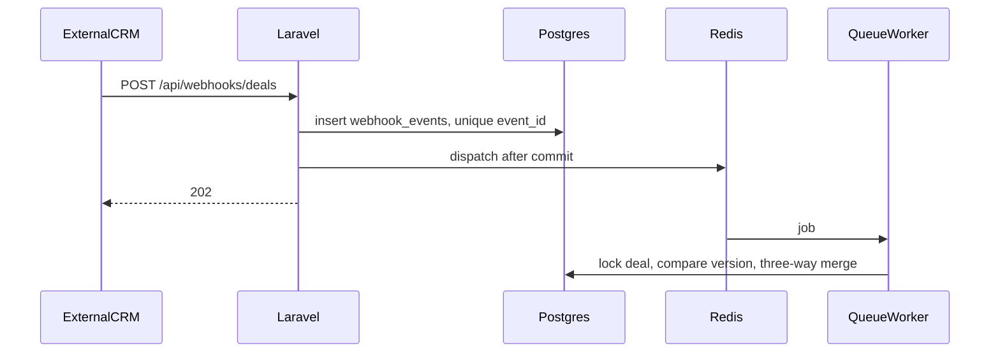

# Учебная CRM сделок

Небольшая CRM: сделки правятся локально и приходят из учебной внешней системы через webhook и GET. Внешняя система в этом репозитории — mock API, не настоящий Bitrix24.

## Стек

- PHP 8.4, Laravel 12
- PostgreSQL 16
- Redis 7
- React 19, TypeScript, Vite 6
- Docker Compose

## Запуск

```bash
cp backend/.env.example backend/.env
# WEBHOOK_TOKEN в .env.example пустой — задайте любой непустой секрет
# в backend/.env перед первым запуском, иначе все webhook отклоняются 401.
# APP_KEY пустой: контейнер сгенерирует его при первом старте, если ключа нет.
docker compose up --build
```

- интерфейс: http://localhost:5173
- API: http://localhost:8000
- PostgreSQL на хосте: `localhost:54329`, база `crm`, пользователь и пароль `crm`
- Redis на хосте: `localhost:6380`

Тесты:

```bash
docker compose run --rm app php artisan test
```

Они ходят в базу `crm_testing` и Redis DB 1. Очередь в тестах повторов — Redis, обработка webhook в остальных тестах — sync.

## Как устроен синк



Webhook отвечает 202 только после commit строки `webhook_events`. Если Redis недоступен уже после commit, строка остаётся `received`, а `php artisan sync:recover` (каждую минуту в контейнере `scheduler`) ставит её в очередь снова. Повтор того же `event_id` упирается в уникальный индекс и не применяет изменение второй раз. Так же при двух одновременных доставках: одна вставка проходит, вторая получает конфликт уникальности.

Статусы события: `received`, `processing`, `applied`, `skipped`, `failed`. Зависший `processing` с истёкшим `lease_until` снова становится `received`.

Кнопка «Обновить из внешней CRM» пишет `refresh_operations` со статусом `accepted` и только потом ставит задачу. Статусы операции: `accepted`, `running`, `succeeded`, `failed`. Успешный HTTP 200 не означает, что поля применились: в `outcome` будет `applied`, `skipped` или `inconsistency`.

## Кто чем владеет

Внешняя CRM владеет снимком: `external_version`, `external_updated_at`, `external_title`, `external_status`, `external_amount`. Версия монотонная, сравнение только числовое.

Локальная CRM владеет правками сотрудника. Они лежат в `deal_field_overrides` (`base_value`, `local_value`, `is_conflicted`), уникальность `(deal_id, field_name)`. На экран попадает локальное значение, если правка есть, иначе внешний снимок. У ручной сделки без внешнего снимка значения лежат в `deals.title/status/amount`. Пока нет `external_id`, кнопка обновления недоступна и наружу ничего не уходит.

`PATCH /api/deals/{id}` принимает только `title`, `status`, `amount`. Поставить `external_id` снаружи нельзя: его выдаёт только внешняя CRM через успешный `ExportDealJob`. Это защищает от «присвоения» чужой сделки правкой поля.

`external_updated_at` и `event_time` на экран и в журнал, но не в сравнение. Last-Write-Wins по времени здесь неверен: событие может прийти позже, хотя версия сделки старше, а часы двух систем не являются общим счётчиком.

Создание сделки — единственный исходящий вызов. Форма пишет локальную строку и `deal_exports`, затем задача вызывает `POST /mock-api/deals` с ключом идемпотентности `deal-{id}`. Номер выдаёт mock CRM. Повтор того же ключа возвращает тот же `external_id` и не создаёт вторую сделку. Успешный ответ становится внешним снимком версии 1. Если CRM не ответила, строка остаётся без номера, отправку можно повторить. Правки полей после создания наружу не уходят.

## Three-way merge

Для каждого поля `title`, `status`, `amount`:

- `base` — внешнее значение в момент первой локальной правки. Повторные правки базу не сдвигают.
- `local` — текущее значение сотрудника.
- `remote` — значение более новой внешней версии.

Правила, когда пришла строго большая версия:

1. Правки нет — берём remote.
2. Remote совпал с base — локальная правка остаётся, конфликта нет.
3. Remote совпал с local — правка снимается, значения сошлись.
4. Обе стороны ушли от base по-разному — локальное значение остаётся, поле помечается конфликтом. Оба значения сохраняются: локальное в override, внешнее в снимке.

Независимые поля сливаются сами. Конфликт суммы не блокирует обновление названия.

Пример. Версия 18: title «Python Course», status NEW, amount 49000. Сотрудник ставит сумму 45000. Версия 19: title «Advanced Python Course», status NEW, amount 52000. Название становится внешним, сумма на экране остаётся 45000, внешняя сумма 52000, поле в конфликте, версия 19.

Старая версия не записывается. Та же версия с другим телом пишется в `source_inconsistencies` и сделку не меняет. Та же версия с тем же телом — пустой пропуск.

Конфликт виден, пока его явно не разрешат или значения не сойдутся. Возврат remote к старой base сам флаг не снимает.

## Разрешение

`POST /api/deals/{id}/resolutions` с `field`, `action` и `external_version`, которую клиент видел на экране.

- `accept_external` — удаляет правку, на экране текущий внешний снимок, в журнал `resolved_external`. Внешняя CRM не меняется.
- `keep_local` — оставляет локальное значение, записывает текущий внешний снимок как новую base, снимает флаг конфликта, в журнал `resolved_local`. Во внешнюю CRM ничего не уходит. Следующее внешнее изменение может открыть новый конфликт.

Если с момента открытия карточки `external_version` уже другая, ответ 409. Клиент перечитывает сделку. Разрешение по устаревшему снимку не выполняется.

Журнал: `field_conflict_logs`, состояния `detected`, `resolved_external`, `resolved_local`, `converged`.

Технический сбой задачи (`failed`, исчерпаны попытки или оборвался воркер) — это не бизнес-конфликт. Конфликт при `succeeded` и `outcome=applied` — успешный синк, в котором часть полей ждёт человека.

## Повторы внешнего GET

Задача делает не больше трёх HTTP-попыток. Повторяются 429, 500, 502, 503, 504 и обрыв соединения. Пауза растёт: по умолчанию 200, 500, 1000 мс. Если в ответе есть `Retry-After`, берётся он, но не дольше `SYNC_RETRY_AFTER_CAP_SECONDS` (5 секунд). Обычный 4xx, например 404, не повторяется. Повтор самой задачи очередью выключен (`tries = 1`), поэтому постоянные 500 заканчиваются статусом `failed`, а не бесконечным циклом.

Пауза между попытками реализована не `usleep` внутри воркера, а повторной постановкой того же job с `delay`. Один rate_limit не держит воркера, пока ждёт `Retry-After`.

Повторный клик по «Обновить из внешней CRM» или «Повторить отправку», пока предыдущая операция в `accepted`/`running`, отбивается ответом 409: уникальный частичный индекс в БД гарантирует одну pending-операцию на сделку. Фронт тоже дизейблит обе кнопки на время pending.

## Mock API

`GET /mock-api/deals/{id}?scenario=success|rate_limit|failure`

Счётчик в Redis: `mock:scenario:{scenario}:deal:{id}`.

- `success` — всегда 200
- `rate_limit` — первые два запроса 429, третий и следующие 200
- `failure` — всегда 500

Данные mock лежат в `external_snapshots`, отдельно от сделок.

```bash
docker compose exec app php artisan mock:set 5678 --external-version=19 --title="Advanced Python Course" --status=NEW --amount=52000
docker compose exec app php artisan mock:reset 5678
```

Сброс нужен, чтобы снова увидеть два ответа 429. На карточке сделки тот же сценарий выбирается перед кнопкой обновления.

Webhook:

```bash
curl -s -D - -X POST http://localhost:8000/api/webhooks/deals \
  -H "Content-Type: application/json" \
  -H "X-Webhook-Token: local-dev-token" \
  -d '{"event_id":"evt_123","event_time":"2026-10-15T15:30:00Z","deal":{"id":"5678","version":18,"updated_at":"2026-10-15T15:29:50Z","title":"Продажа курса","status":"NEW","amount":49000}}'
```

Секрет читается из `WEBHOOK_TOKEN`, сравнивается через `hash_equals` и в логи не пишется.

## Индексы

- Уникальный частичный `deals.external_id` — одна локальная сделка на внешний id и защита от двух одновременных вставок. Несколько ручных сделок с пустым id при этом возможны.
- Уникальный `webhook_events.event_id` — идемпотентность webhook, в том числе при гонке.
- `(status, dispatch_after)` на `webhook_events` — восстановление выбирает только готовые к отправке строки.
- `webhook_events.external_id` — для выборок событий по сделке.
- `(status, created_at)` на `refresh_operations` — зависшие и недавние операции.
- `(deal_id, id)` на `refresh_operations` — последнее состояние кнопки.
- Уникальный частичный `refresh_operations (deal_id) WHERE status IN ('accepted','running')` — одна pending операция на сделку.
- Уникальный частичный `deal_exports (deal_id) WHERE status IN ('accepted','running')` — одна pending отправка на сделку.
- Уникальный `(deal_id, field_name)` на правках — одна база на поле.
- Функциональный индекс `deals ((COALESCE(external_status, status)))` — фильтр списка по отображаемому статусу без JOIN на override.
- GIN trigram `deals ((COALESCE(external_title, title)) gin_trgm_ops)` — ILIKE-поиск по названию становится индексным.

Поиск и фильтр по списку сознательно смотрят на пару «внешнее приоритетнее ручного» без JOIN на `deal_field_overrides`: это держит запрос индексным. Локальные правки поля в фильтр не попадают — компромисс в пользу скорости. Полное покрытие (включая override) потребовало бы materialized view и выходит за рамки задания.

## Что было бы нужно для двустороннего синка

Сейчас локальная правка не уходит наружу. Обратная запись — отдельный исходящий конвейер: идемпотентность, защита от петли «мы записали — нам прилетел webhook», повторы, и проверка версии уже на стороне внешней CRM. Нельзя считать, что у Bitrix24 есть атомарное условное обновление по учебному `external_version` из этого задания. Пока такого контракта нет, молчаливая отправка локальных полей может затереть более новую правку в Bitrix.

Для production ещё понадобятся: аутентификация сотрудников, нормальный секрет webhook вне репозитория, периодический догон пропущенных webhook тем же правилом версии, метрики очереди и ограничения на размер пачки recovery.

## Инструменты

Каркас, синхронизация, интерфейс, тесты и тексты собраны в Cursor с моделью Grok. На защите код нужно уметь объяснить и поменять самостоятельно.

## Время

Фактическая разработка 22 октября 2026: около 3 часов, с 10:00 до 13:00.
